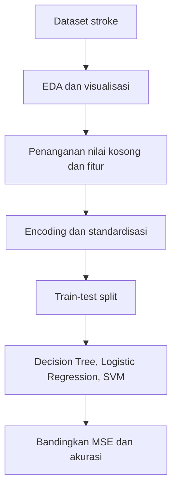

# Analisis dan Prediksi Risiko Stroke

Repository ini berisi notebook analisis dan script Python untuk mengeksplorasi dataset prediksi stroke. Tujuannya adalah latihan analisis data dan perbandingan model klasifikasi, bukan alat diagnosis medis.

## Alur analisis

Notebook `Stroke_Risk_Predictive_Analysis.ipynb` memuat eksplorasi, pemrosesan, dan eksperimen model. Script `stroke_risk_predictive_analysis.py` juga tersedia. Dataset `healthcare-dataset-stroke-data.csv` berada di repository.

## Visualisasi

## Menjalankan

Notebook dibuat di Google Colab dan beberapa sel menggunakan path Google Drive. Sesuaikan path dataset dengan lokasi file lokal sebelum menjalankan.

Script juga mengasumsikan path dataset di lingkungan Colab. Untuk menjalankannya di komputer lokal, ubah path pembacaan CSV pada script terlebih dahulu.

Dependensi yang dipakai mencakup Python, pandas, NumPy, Matplotlib, Seaborn, dan scikit-learn. Repository tidak menyediakan `requirements.txt`.

## Catatan interpretasi

- Kelas pada dataset tidak seimbang; akurasi saja tidak cukup untuk menilai model.
- Notebook membandingkan Decision Tree, Logistic Regression, dan SVM serta menampilkan MSE dan akurasi. Jalankan ulang untuk memeriksa hasil pada lingkungan Anda.
- Model ini bersifat edukasional dan tidak boleh digunakan untuk mendiagnosis atau menentukan perawatan pasien.
